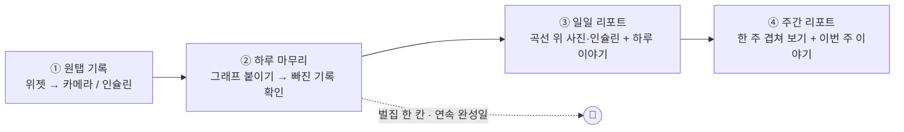
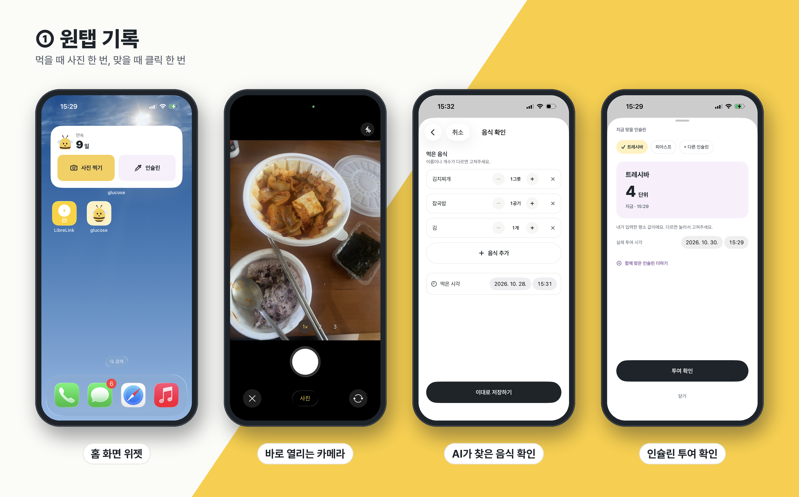
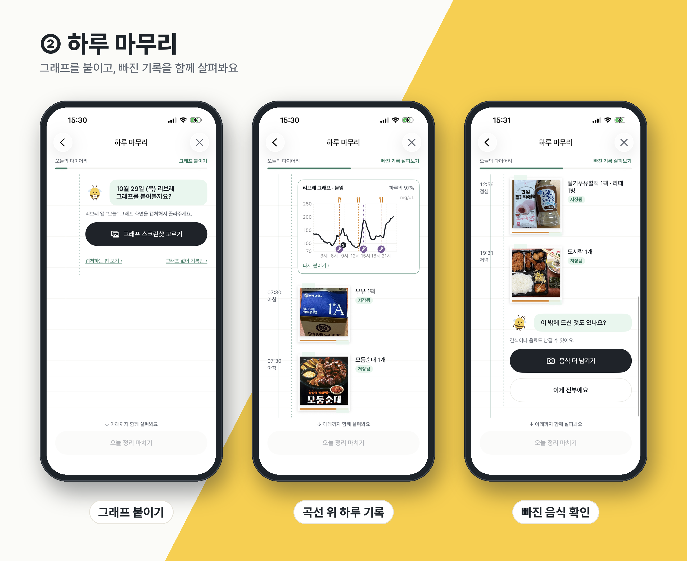
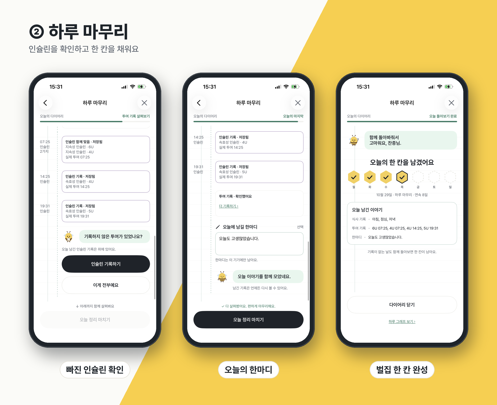
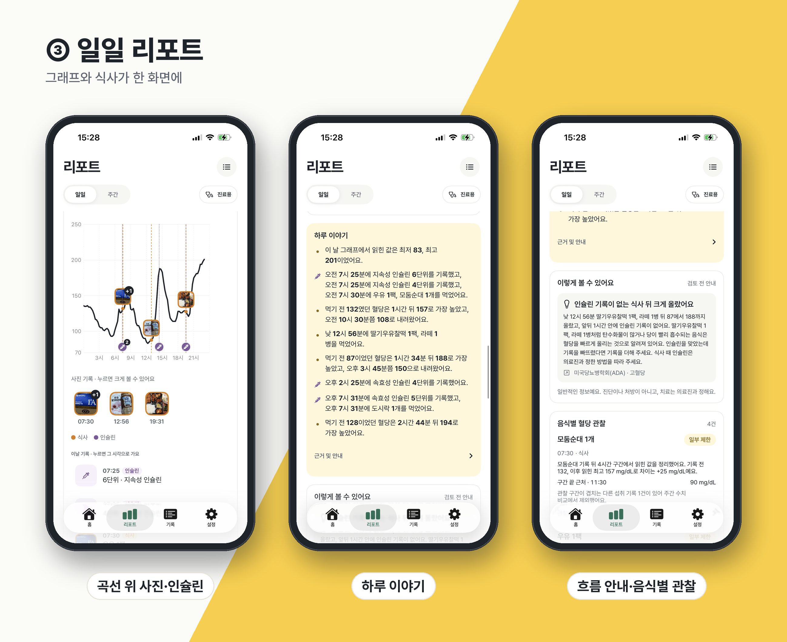
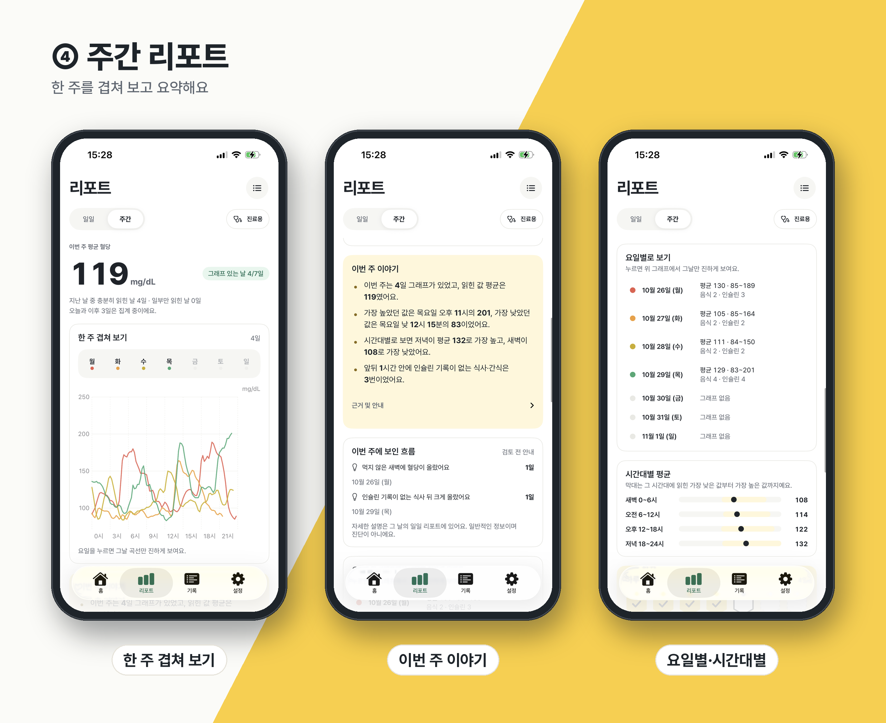
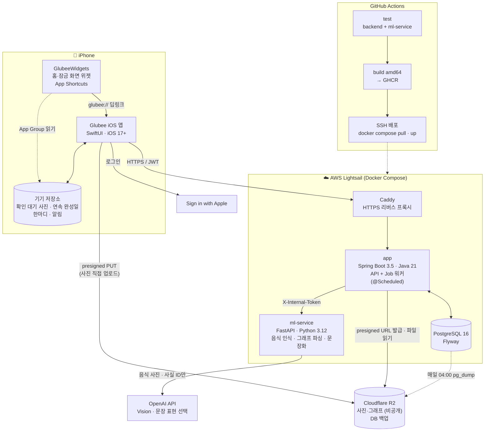
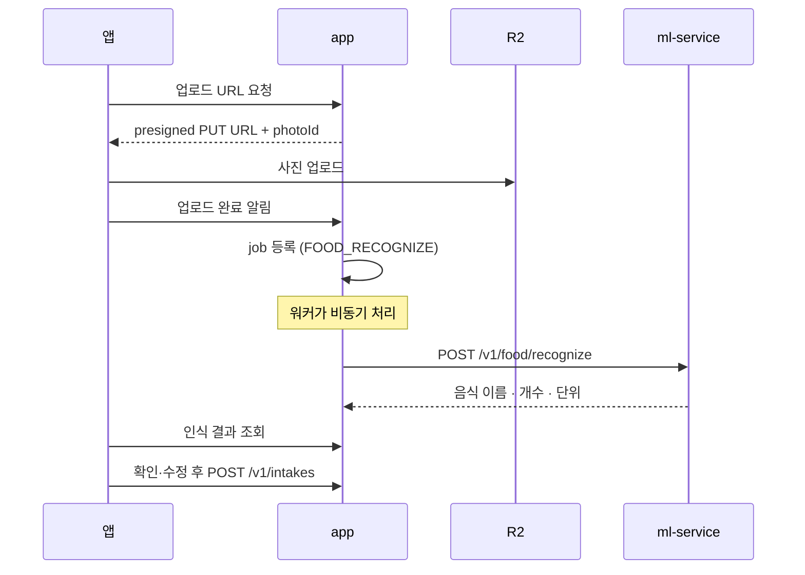
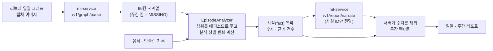

<div align="center">


# Glubee 🐝

### 사진 한 장으로 남기는 혈당 다이어리

**먹을 때 사진 한 번, 맞을 때 클릭 한 번.**<br/>
하루 끝에 리브레 그래프를 붙이면, 그날의 식사·인슐린·혈당 곡선이 한 장의 다이어리로 완성돼요.


</div>

Glubee는 CGM(연속혈당측정기, 예: FreeStyle Libre)을 쓰며 인슐린을 맞는 사람을 위한 iOS 앱과 백엔드입니다.
식사 사진과 인슐린 기록을 남기고, **일일 그래프 이미지**에서 읽은 혈당 곡선과 맞춰 일일·주간 리포트를 만듭니다.

| 원칙 | 내용 |
|---|---|
| AI는 인식까지만 | AI는 "무엇을 몇 개 먹었는지"만 알아봅니다. 숫자와 판단(식후 변화, 처치·반동 판정)은 **코드가 계산**합니다. |
| 숫자는 코드, 문장만 AI | 리포트 문장은 서버가 숫자를 채워 만듭니다. AI에는 수치 없이 **사실 ID만** 보내 문단 구성과 표현만 고르게 합니다. |
| 조언하지 않기 | 인슐린 용량·식사량 조언은 하지 않습니다. 일반 목표 범위와 비교하지 않고, 근거 건수와 함께 사실만 보여줍니다. |
| 끊긴 곳은 비워두기 | 그래프가 끊긴 구간은 보간하지 않고 비워둡니다(`MISSING`). |

---

## 목차
1. [사용자 흐름](#사용자-흐름)
2. [시스템 아키텍처](#시스템-아키텍처)
3. [데이터 처리 흐름](#데이터-처리-흐름)
4. [주요 기능](#주요-기능)
5. [기술 스택](#기술-스택)
6. [저장소 구조](#저장소-구조)
7. [시작하기](#시작하기)
8. [테스트](#테스트)
9. [배포·운영](#배포운영)
10. [보안·개인정보](#보안개인정보)
11. [문서](#문서)

---

## 사용자 흐름

하루는 네 단계로 흘러갑니다. **낮에는 빠르게 남기고, 밤에 한 번 함께 완성**하는 구조예요.




### ① 원탭 기록 — 먹을 때 사진 한 번, 맞을 때 클릭 한 번

<p align="center"></p>

| 화면 | 하는 일 |
|---|---|
| **홈 화면 위젯** | "사진 찍기"와 "인슐린" 두 버튼, 그리고 연속 완성일을 보여줍니다. 잠금 화면 위젯, 단축어·Siri·동작 버튼에서도 같은 화면으로 갑니다(`glubee://capture`, `glubee://insulin`). |
| **바로 열리는 카메라** | 앱이 카메라로 바로 열립니다. 찍으면 끝이에요. 업로드와 인식은 뒤에서 진행되고, 기록 시각은 **촬영 시각**으로 남습니다. |
| **AI가 찾은 음식 확인** | 인식된 음식(예: 김치찌개 1그릇, 잡곡밥 1공기, 김 1개)의 이름·개수·먹은 시각을 고치고 "이대로 저장하기"를 누릅니다. 하루 마무리 때 몰아서 확인해도 됩니다. |
| **인슐린 투여 확인** | 설정에 직접 넣은 **평소 인슐린**(제품·단위)이 미리 채워져 있어 "투여 확인" 한 번이면 저장됩니다. 실제 투여 시각을 바꿀 수 있고, 다른 인슐린을 추가하거나 **함께 맞은 인슐린**을 같은 시각으로 저장할 수 있습니다. |

> 평소 인슐린 값은 사용자가 입력한 값 그대로 씁니다. 앱이 계산하거나 추천하지 않습니다.

### ② 하루 마무리 — 그래프를 붙이고, 빠진 기록을 함께 살펴봐요

저녁 알림(기본 21:00)이나 홈에서 시작합니다. 한 장의 줄노트 다이어리를 위에서 아래로 내려가며 채웁니다.

<p align="center"></p>

<p align="center"></p>

| 단계 | 화면 | 하는 일 |
|---|---|---|
| 1 | **그래프 붙이기** | 리브레 앱의 "오늘" 그래프 화면을 캡처해 고릅니다. 그래프 없이 기록만 남길 수도 있습니다. |
| 2 | **곡선 위 하루 기록** | 읽어낸 혈당 곡선 위에 식사(🍴)와 인슐린(💉) 표시가 올라가고, 아래로 시간순 사진 기록이 이어집니다. |
| 3 | **빠진 음식 확인** | "이 밖에 드신 것도 있나요?" — 간식·음료를 더 남기거나 "이게 전부예요"로 넘어갑니다. 확인을 기다리는 사진도 여기서 정리합니다. |
| 4 | **빠진 인슐린 확인** | 그날 투여 기록을 시간순으로 보여줍니다. 같은 시각에 맞은 인슐린은 "인슐린 함께 맞음" 한 칸으로 묶습니다. |
| 5 | **오늘의 한마디** | 선택 사항입니다. 한마디는 이 기기에만 남습니다. |
| 6 | **벌집 한 칸 완성** | 이번 주 벌집에 한 칸이 채워지고, 오늘 남긴 이야기(식사·투여·한마디)를 요약합니다. |

- 지난 날짜도 홈 다이어리에서 그 날로 이동해 마무리할 수 있습니다.
- **연속 완성일**: 마무리한 날이 이어지면 연속 일수가 늘어납니다. 7일 연속마다 **꿀단지** 1개(최대 2개)를 받고, 빠뜨린 날에 자동으로 써서 연속을 지켜줍니다.

### ③ 일일 리포트 — 그래프와 식사가 한 화면에

<p align="center"></p>

| 화면 | 하는 일 |
|---|---|
| **곡선 위 사진·인슐린** | 평균 혈당 아래에 하루 곡선이 있고, 그 위에 음식 사진 썸네일과 인슐린 표시가 올라갑니다. 곡선을 누르면 그 시각의 값을 볼 수 있습니다. 날짜를 누르면 달력으로 다른 날로 이동합니다. |
| **하루 이야기** | 읽힌 최저·최고값, 식사와 인슐린 기록, 먹기 전 혈당과 식후 최고값을 시간순 문장으로 정리합니다. |
| **흐름 안내·음식별 관찰** | "이렇게 볼 수 있어요"는 근거 자료와 함께 보여주는 일반 정보입니다(의료인 검토 전이라 서버 설정으로 켜고 끕니다). 음식별 관찰에서는 기록 전후 구간의 값과 근거 건수를 보여줍니다. |

### ④ 주간 리포트 — 한 주를 겹쳐 보고 요약해요

<p align="center"></p>

| 화면 | 하는 일 |
|---|---|
| **한 주 겹쳐 보기** | 이번 주 평균 혈당, 그래프가 있는 날 수, 요일별 곡선을 한 그래프에 겹쳐 그립니다. 요일을 누르면 그날 곡선만 진하게 보입니다. |
| **이번 주 이야기** | 평균, 가장 높고 낮았던 시각, 시간대별 특징, 인슐린 기록 없이 지난 식사 수를 요약하고, 이번 주에 보인 흐름을 날짜와 함께 보여줍니다. |
| **요일별·시간대별** | 요일마다 평균·범위·음식·인슐린 건수를 보여주고, 새벽·오전·오후·저녁 시간대별 범위와 평균을 막대로 보여줍니다. |

리포트 화면의 **진료용** 버튼은 진료 때 보여주기 좋게 정리한 화면을 엽니다.

### 탭 구성

| 탭 | 내용 |
|---|---|
| **홈** | 글루비 인사, 이번 주 벌집, **오늘의 다이어리**(시간별 줄노트 타임라인 · 그 자리에서 수정 · 지난 날짜 이동), 하루 마무리 버튼 |
| **리포트** | 일일 / 주간 / 진료용 |
| **기록** | 음식·인슐린 기록 목록, 상세, 수정·삭제 |
| **설정** | 평소 인슐린, 식사·마무리 알림, 위젯 안내, 계정 |

---

## 시스템 아키텍처



| 구성 요소 | 역할 |
|---|---|
| **iOS 앱** | 기록·하루 마무리·리포트 화면. 사진은 서버를 거치지 않고 R2에 바로 올립니다. |
| **위젯** | 서버를 호출하지 않습니다. 딥링크로 앱 화면을 열고, App Group으로 연속 완성일만 읽습니다. |
| **app (백엔드)** | 인증(Apple → 자체 JWT), 기록 CRUD, 그래프·음식 분석 job, 에피소드 분석, 리포트 생성. 무거운 처리는 `job` 테이블과 `@Scheduled` 워커가 비동기로 처리하므로 앱 요청은 ml-service 응답을 기다리지 않습니다. |
| **ml-service** | 음식 사진을 이름·개수·단위로 구조화(OpenAI Vision)하고, 리브레 일일 그래프를 15분 간격 96칸 시계열로 변환(OpenCV + Tesseract OCR)합니다. 리포트 문단 구성도 고릅니다. 영양 수치(g, kcal)는 반환하지 않습니다. |
| **PostgreSQL** | 스키마는 Flyway 마이그레이션으로만 변경합니다(`ddl-auto: validate`). 외부 포트는 열지 않습니다. |
| **Cloudflare R2** | 음식 사진·그래프 이미지(비공개 버킷)와 매일 DB 백업(30일 보관)을 저장합니다. |

---

## 데이터 처리 흐름

### 음식 사진 → 기록



### 그래프 이미지 → 리포트



**분석 규칙**
- 60~90분 안의 섭취는 하나의 에피소드로 묶습니다.
- 분석 창: 식사 3~5시간, 저혈당 처치 2시간(직전 혈당이 70 미만이면 자동으로 처치로 분류), 술 12시간.
- 반동 판정: 처치 후 분석 창 안에서 180 mg/dL 초과.
- 그래프 1장 = 하루. 그래프에서 읽힌 칸 비율(`coverage_ratio`)이 0.1 미만이면 거절(422). 같은 날 다시 올리면 덮어씁니다.
- 문장화가 실패하거나 검증을 통과하지 못하면 고정 요약 문장으로 대체합니다.

---

## 주요 기능

**기록**
- 위젯 원탭 촬영, 확인 대기 사진(네트워크 실패 시 앱을 다시 열 때 재시도)
- AI 음식 인식 결과 확인·수정(이름·개수·단위·시각), 포장 식품 인식
- 상황 구분: 식사, 간식, 저혈당 처치, 술
- 인슐린 투여 확인: 평소 인슐린 미리 채우기, 실제 투여 시각, 다른 인슐린 추가, 함께 맞은 인슐린, 평소 값 고치기

**하루 마무리와 계속 쓰게 하는 장치**
- 줄노트 다이어리 형식의 하루 마무리(그래프 → 음식 → 인슐린 → 한마디 → 완성)
- 홈 다이어리: 시간별 타임라인, 사진 폴라로이드, 그 자리에서 수정, 지난 날짜 이동
- 연속 완성일, 이번 주 벌집, 꿀단지(빠진 날 지켜주기), 쉬어가기
- 마스코트 **글루비**의 해요체 안내, 온보딩
- 로컬 알림: 식사 기록 알림, 하루 마무리 알림

**리포트**
- 일일: 평균 혈당, 곡선 위 사진·인슐린 표시, 확대·탭 선택, 하루 이야기, 흐름 안내, 음식별 관찰, 달력 이동
- 주간: 한 주 겹쳐 보기, 이번 주 이야기, 이번 주에 보인 흐름, 요일별·시간대별 요약
- 진료용 화면

**계정**
- Sign in with Apple, 계정 삭제(서버 데이터와 기기 데이터 모두 지우기)

---

## 기술 스택

| 영역 | 기술 |
|---|---|
| iOS | SwiftUI, Swift Charts, WidgetKit, App Intents, AVFoundation, UserNotifications, iOS 17+, Pretendard |
| Backend | Spring Boot 3.5, Java 21, Gradle, Spring Security(JWT), Spring Data JPA, Flyway, Actuator |
| ML | FastAPI, Python 3.12, OpenAI Vision, OpenCV, Tesseract OCR(영문·한글) |
| DB / 저장소 | PostgreSQL 16, Cloudflare R2(S3 호환, presigned URL) |
| 인프라 | AWS Lightsail(서울), Docker Compose, Caddy, GHCR, GitHub Actions |
| 테스트 | JUnit 5 + Testcontainers, pytest, XCTest / XCUITest |

---

## 저장소 구조

```
glucose/
├── ios/glucose/                 iOS 앱 (Bundle ID com.glubee.glubee)
│   ├── glucose/
│   │   ├── App/                 앱 진입점, 딥링크, DEBUG 실행 인자
│   │   ├── Core/                Auth · DesignSystem · Media · Models · Network
│   │   │                        Notifications · Storage · Widget
│   │   └── Features/            Home · Intake · Insulin · DayClose · Graph
│   │                            Reports · Records · Onboarding · Settings · Review · Auth
│   ├── GlubeeWidgets/           홈·잠금 화면 위젯
│   ├── glucoseTests/            단위 테스트
│   └── glucoseUITests/          UI 테스트
├── backend/                     Spring Boot (패키지 com.glucoselog)
│   └── src/main/java/com/glucoselog/
│       ├── auth · account       Sign in with Apple, JWT, 계정 삭제
│       ├── photo                R2 presigned 업로드
│       ├── intake · insulin     기록 CRUD, food_catalog
│       ├── glucose              그래프 업로드·시계열
│       ├── job · ml             비동기 job 워커, ml-service 클라이언트
│       ├── episode              에피소드·반동 판정 (EpisodeAnalyzer)
│       └── report               일일·주간 리포트, 하루 이야기
├── ml-service/                  FastAPI 음식 인식 · 그래프 파서 · 문장화
├── eval/food/                   음식 인식 평가 라벨 (이미지는 저장소 밖)
├── infra/                       백업 복구 테스트, 데모 날짜 이동 스크립트
├── docs/                        API 계약·설계 문서
└── .github/workflows/deploy.yml main push → 테스트 → 빌드 → 배포
```

---

## 시작하기

### 준비물
- Xcode 26 이상(iOS 17+ 대상), JDK 21, Python 3.12, Docker

### 백엔드 + ml-service (로컬)

```bash
# 로컬 DB와 ml-service를 함께 실행
docker compose -f backend/docker-compose.local.yml up --build

# 또는 DB만 띄우고 백엔드를 직접 실행
docker compose -f backend/docker-compose.local.yml up -d postgres
cd backend && ./gradlew bootRun
```

ml-service만 직접 실행할 때:

```bash
python -m pip install -r ml-service/requirements-dev.txt
python -m uvicorn main:app --app-dir ml-service --reload
```

환경 변수는 `.env`로 넣습니다(저장소에 커밋하지 않음). ml-service에 필요한 값은 [`ml-service/README.md`](ml-service/README.md)를 참고하세요.

### iOS

```bash
open ios/glucose/glucose.xcodeproj
```

명령줄 빌드:

```bash
DEVELOPER_DIR=/Applications/Xcode.app/Contents/Developer \
xcodebuild -scheme glucose -sdk iphonesimulator \
  -destination 'generic/platform=iOS Simulator' CODE_SIGNING_ALLOWED=NO build
```

- 실기기에 설치하려면 App Group `group.com.glubee.glubee`가 Apple Developer 계정에 등록돼 있어야 합니다.
- **로그인 없이 화면 보기**: DEBUG 빌드에서 실행 인자로 원하는 화면을 바로 엽니다.

| 실행 인자 | 화면 |
|---|---|
| `-home [-homeSeed \| -homeRest]` | 홈 |
| `-capture`, `-recognition` | 카메라, 음식 인식 결과 |
| `-insulinConfirm` | 인슐린 투여 확인 |
| `-dayClose -dayCloseStep N` | 하루 마무리 |
| `-reports [-reportSample] [-weekly \| -clinician]` | 리포트 |
| `-graphUpload [-graphUploadSample]` | 혈당 그래프 올리기 |
| `-onboardingStep N`, `-settings`, `-tabs`, `-designCatalog` | 온보딩, 설정, 탭, 디자인 카탈로그 |

---

## 테스트

```bash
# 백엔드 (Docker 필요: Testcontainers PostgreSQL 16)
cd backend && ./gradlew test

# ml-service
make test-ml

# 음식 인식 평가 (비공개 이미지 필요)
make eval LABELS=eval/food/labels.json IMAGES=<이미지 폴더>

# iOS
DEVELOPER_DIR=/Applications/Xcode.app/Contents/Developer \
xcodebuild test -scheme glucose -destination 'platform=iOS Simulator,name=<시뮬레이터 이름>'
```

---

## 배포·운영

- **main에 머지되면 자동 배포**됩니다: 테스트(backend + ml-service) → amd64 이미지 빌드 → GHCR(`glucose-app`, `glucose-ml`) → SSH로 서버에서 `docker compose pull && up`.
- 서버 1대에 `caddy`, `app`, `ml-service`, `postgres` 컨테이너가 돌고 외부 포트는 22/80/443만 엽니다. 재시작 정책은 `unless-stopped`입니다.
- 매일 04:00 DB 백업을 R2에 올립니다(30일 보관). 복구 테스트와 장애 복구 절차는 [`infra/README.md`](infra/README.md)에 있습니다.
- 서버 주소·SSH 키는 GitHub Secrets에만 있고, 이 저장소에는 쓰지 않습니다.

### 작업 규칙
- main에 직접 푸시하지 않습니다. 브랜치 → PR → 리뷰 후 머지합니다.
- ml-service 계약을 바꿀 때는 코드보다 [`docs/ml-service-contract.md`](docs/ml-service-contract.md)를 먼저 고칩니다.
- API 응답 필드는 snake_case, 오류 응답은 `{code, message, request_id}` 형식입니다.

---

## 보안·개인정보

- `.env`, API 키, `.pem`, 혈당 CSV, 그래프 이미지, PDF, 음식 사진은 **커밋하지 않습니다.** 테스트 데이터는 팀 비공개 드라이브로만 공유합니다.
- 로그에 혈당값, 사진 URL, 토큰, 이미지나 AI 응답 원문을 남기지 않습니다.
- 사진·그래프는 비공개 R2 버킷에 두고, 짧게 유효한 presigned URL로만 주고받습니다.
- OpenAI에는 음식 사진(인식용)과 리포트 사실 ID만 보냅니다. 혈당 수치, 날짜, 사용자 정보, 자유 메모는 보내지 않습니다.
- 하루 마무리 한마디는 기기에만 저장합니다. 계정을 삭제하면 서버 데이터와 기기 데이터를 함께 지웁니다.
- Glubee는 기록과 정리를 돕는 앱이며 진단이나 처방을 하지 않습니다. 치료는 의료진과 정합니다.

---

## 문서

| 문서 | 내용 |
|---|---|
| [`docs/backend-api.md`](docs/backend-api.md) | 앱 ↔ 백엔드 API |
| [`docs/ml-service-contract.md`](docs/ml-service-contract.md) | 백엔드 ↔ ml-service 계약(정답 문서) |
| [`docs/backend-plan.md`](docs/backend-plan.md) | 백엔드 작업 순서 |
| [`docs/ios-design-v4.md`](docs/ios-design-v4.md) | iOS 핵심 흐름·디자인 결정 |
| [`docs/report-narration.md`](docs/report-narration.md) | 근거 기반 리포트 문장화 |
| [`docs/report-story-and-guidance-plan.md`](docs/report-story-and-guidance-plan.md) | 하루 이야기·흐름 안내 설계 |
| [`docs/guidance-cards.md`](docs/guidance-cards.md) | 흐름 안내 카드와 근거 자료 |
| [`docs/food-observations.md`](docs/food-observations.md) | 음식별 관찰 |
| [`docs/graph-pipeline-fix.md`](docs/graph-pipeline-fix.md) | 그래프 파이프라인 개선 기록 |
| [`infra/README.md`](infra/README.md) | 백업·복구 운영 절차 |
| [`ml-service/README.md`](ml-service/README.md) | ml-service 실행·그래프 파서 전제 |
